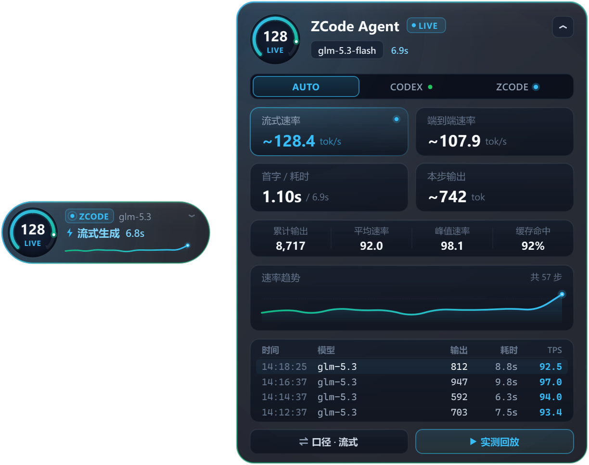

# Codex & ZCode 实时 Token 速度悬浮球（TPS Floating Ball）


一个专为 Windows 桌面环境设计的轻量级置顶悬浮球工具，在 **OpenAI Codex（`~/.codex`）** 或 **ZCode（`~/.zcode`）** 运行时，以**零侵入、只读无锁、真实 API Token 统计**的方式，实时监控并显示模型的 Token 输出速度（**TPS, Tokens Per Second**）。

> 🔒 **隐私与安全**：本工具不联网、不上传任何数据。全部数据均来自 Codex / ZCode 本地落盘的权威 API Usage 记录，并以 SQLite 只读模式（`mode=ro`）与文件增量读取方式采集，绝不写入或修改任何原始数据。



## 目录

- [功能特性](#功能特性)
- [环境要求](#环境要求)
- [安装](#安装)
- [快速开始](#快速开始)
- [交互操作指南](#交互操作指南)
- [命令行参数](#命令行参数)
- [双口径 TPS 计算公式](#双口径-tps-计算公式)
- [工作原理](#工作原理)
- [项目结构](#项目结构)
- [常见问题](#常见问题)
- [许可证](#许可证)

---

## 功能特性

- **真实 Token 统计**：直接读取 OpenAI API Usage 与 ZCode `model_usage` 的权威记录，拒绝「按字符长度或正则分词粗略估算」的不准确方式。
- **双口径 TPS**：「纯流式 TPS」（剔除首字等待 TTFT）与「端到端 TPS」，可在界面或右键菜单一键切换。
- **亚秒级流式状态检测**：以 150ms 轮询间隔实时识别 `REASONING` / `STREAMING` / `TOOL EXEC` / `THINKING` / `READY` 等运行状态。
- **双引擎监控**：`AUTO` / `CODEX` / `ZCODE` 三种监控源，`AUTO` 模式自动跟随当前正在流式输出或最近活跃的引擎。
- **HUD 数据仪表盘**：当前模型、TTFT、会话累计 Token（含推理 / 缓存）、平均与峰值 TPS、最近一步完整详情。
- **动态回放实测**：将本机最近真实的 Codex / ZCode 响应记录，按「流式生成 → 完成结算」完整动态回放一遍。
- **桌面级体验**：自由拖动、双击展开 / 收起、始终置顶、锁定位置、系统托盘、`Ctrl + 滚轮` 无级透明度（40% ~ 100%）、单实例自动接管。

## 环境要求

| 项目 | 要求 |
| --- | --- |
| 操作系统 | Windows 10 / 11 |
| Python | 3.9 及以上（建议 3.10+） |
| Qt 绑定 | PySide6（首选）或 PyQt5（程序自动回退） |
| 可选依赖 | psutil（推荐，用于流式过程中的进程 I/O 实时探测） |

## 安装

```powershell
git clone https://github.com/Sujinxin123/codex-zcode-TPS.git
cd codex-zcode-TPS
pip install -r requirements.txt
```

或手动安装依赖：

```powershell
pip install PySide6 psutil
```

> 若偏好 PyQt5，可安装 `PyQt5` 并卸载 PySide6，程序启动时会自动选择可用的 Qt 绑定。

## 快速开始

### 方式一：一键启动（推荐）

双击项目目录下的 [`run_floating_ball.bat`](./run_floating_ball.bat)。脚本会自动查找本机 Python（`pythonw.exe` 优先），在后台无黑框启动悬浮球。

### 方式二：命令行启动

```powershell
# 启动悬浮球（默认紧凑胶囊态）
python tps_floating_ball.py

# 启动时直接展开 HUD 详情仪表盘
python tps_floating_ball.py --expanded

# 运行本地真实数据解析自检（命令行输出 ~/.codex 与 ~/.zcode 统计结果）
python tps_floating_ball.py --self-test
```

## 交互操作指南

- **自由拖动**：鼠标左键按住悬浮球任意非按钮区域，即可拖拽到屏幕任意位置。
- **展开 / 收起详情面板（HUD）**：**双击悬浮球**或点击右上角 `▾` / `▴` 按钮，在「紧凑悬浮球」与「完整数据仪表盘」之间无缝切换。
- **切换监控源**：在展开面板点击 `AUTO 自动` / `CODEX` / `ZCODE` 标签，或通过右键菜单切换。
- **切换 TPS 口径**：点击展开面板左下角的 `口径: 纯流式 / 端到端` 按钮，或通过右键菜单切换。
- **动态回放实测**：点击展开面板右下角的 `▶ 回放真实数据实测`（或右键菜单中的「回放真实 Token 记录」），将本机最近真实的 Codex 与 ZCode 响应记录完整动态回放一遍。
- **调节透明度**：按住 `Ctrl + 鼠标滚轮` 无级调节窗口透明度（40% ~ 100%），也可在右键菜单中选择预设透明度。
- **系统托盘与右键菜单**：支持「始终置顶」开关、「锁定位置」开关、隐藏到系统托盘及退出程序。

## 命令行参数

| 参数 | 说明 |
| --- | --- |
| `--expanded` | 启动时直接展开 HUD 详情仪表盘 |
| `--self-test` | 对本机 `~/.codex` 与 `~/.zcode` 真实数据运行采集器自检，输出统计结果后退出 |

## 双口径 TPS 计算公式

监控器同时提供两种业界标准的真实 Token 速度口径：

1. **纯流式生成 TPS（Streaming TPS，默认推荐）**——剔除网络与 Prompt 预填充首字等待（TTFT），反映模型纯吐字速度：

   $$\text{TPS}_{\text{stream}} = \frac{\text{Output Tokens}}{(\text{Duration}_{\text{ms}} - \text{TTFT}_{\text{ms}}) / 1000}$$

2. **端到端响应 TPS（End-to-End TPS）**——包含首字等待时间 TTFT，反映从发起请求到响应完毕的整体吞吐速度：

   $$\text{TPS}_{\text{e2e}} = \frac{\text{Output Tokens}}{\text{Duration}_{\text{ms}} / 1000}$$

## 工作原理

为避免「按字符长度或正则分词粗略估算 Token」的不准确方式，本工具直接对接 Codex 与 ZCode 落盘的底层权威 API Usage 数据与流式事件。

### 1. OpenAI Codex（`~/.codex`）

- **核心架构**：Codex Desktop / CLI 底层由 Rust 编写的 `codex_core` 与 `codex_app_server` 驱动。
- **真实 Token 与毫秒级时间锚点（`~/.codex/sessions/YYYY/MM/DD/rollout-*.jsonl`）**：
  - 每当单个模型响应步（Step）完成（即使当前 Turn 仍在继续执行工具调用），Codex 都会立即向当前会话的 `rollout-*.jsonl` 追加一条 `type == "token_usage_record"` 记录：
    ```json
    {
      "type": "token_usage_record",
      "timestamp": "2026-10-09T14:17:23.511Z",
      "payload": {
        "response_id": "resp_...",
        "usage": {
          "input_tokens": 287733,
          "cached_input_tokens": 285440,
          "output_tokens": 664,
          "reasoning_output_tokens": 338,
          "total_tokens": 288397
        }
      }
    }
    ```
    其中 `output_tokens` 是 OpenAI API 返回的**权威总生成 Token 数**（已包含 `reasoning_output_tokens`，满足 `input_tokens + output_tokens == total_tokens`）。
  - 在 `token_usage_record` 之前，同一模型步内的 `event_msg`（`payload.type == "item_completed"`，对应 `Reasoning` 或 `AgentMessage`）精确记录了首 Token 开始流式输出的毫秒时间戳 `started_at_ms` 与完成时间戳 `completed_at_ms`；请求发起时刻则由 `task_started` / `UserMessage` 或上一步工具输出完成事件（`custom_tool_call_output` / `token_count`）锚定。
- **流式生成中（In-Flight Streaming）实时状态检测（`~/.codex/logs_2.sqlite`）**：
  - 在模型正在吐字、尚未生成最终 `token_usage_record` 的流式阶段，Codex 实时向 `~/.codex/logs_2.sqlite`（WAL 模式）写入：
    - `target = 'feedback_tags'` 且包含 `endpoint="/responses"`（模型请求发出）；
    - `target = 'codex_core::stream_events_utils'` 且包含 `Output item`（首 Token 到达）；
    - `target = 'codex_app_server::outgoing_message'` 且包含 `item/agentMessage/delta` 或 `item/reasoning/summaryTextDelta`（实时流式增量块）。

### 2. ZCode（`~/.zcode`）

- **核心架构**：ZCode Desktop（`ZCode.exe`）通过 `zcode-host` 与 Node.js Agent 工作进程（`resources/glm/zcode.cjs`）执行任务。
- **真实 Token 与精确 TTFT 数据（`~/.zcode/cli/db/db.sqlite` -> `model_usage` 表）**：
  - `zcode.cjs` 中的 `recordModelUsage` 在每次模型请求完成时，向 `~/.zcode/cli/db/db.sqlite` 的 `model_usage` 表写入权威指标：
    - **时间指标（毫秒精度）**：`started_at`（请求开始）、`first_token_at`（首 Token 到达）、`completed_at`（流式结束）、`duration_ms`（总耗时）、`time_to_first_token_ms`（首字延迟 **TTFT**）。
    - **真实 Token 指标**：`input_tokens`、`output_tokens`、`reasoning_tokens`、`cache_read_input_tokens`、`computed_total_tokens`。
- **流式生成中（In-Flight Streaming）实时状态检测（`~/.zcode/cli/log/zcode-YYYY-MM-DD.jsonl` 与 `message` 表）**：
  - 当模型请求发起瞬间，ZCode 会立即在 `zcode-YYYY-MM-DD.jsonl` 写入 `"event": "model.request.started"`，并在 `db.sqlite` 的 `message` 表插入一条 `time.completed IS NULL` 的 `assistant` 消息记录；流式结束时写入 `"event": "model.sdk.stream.completed"` 并更新 `model_usage`。

## 项目结构

```
codex-zcode-TPS/
├── tps_floating_ball.py     # 主程序：悬浮球 UI + Codex / ZCode 双引擎数据采集器
├── run_floating_ball.bat    # Windows 一键后台启动脚本（自动查找 Python）
├── requirements.txt         # Python 依赖清单
├── docs/
│   ├── preview.png          # 样式预览头图（紧凑球 + 展开 HUD）
│   ├── preview_compact.png  # 紧凑悬浮球态预览
│   └── preview_expanded.png # 展开 HUD 仪表盘态预览
├── README.md                # 项目说明书
└── LICENSE                  # MIT 许可证
```

## 常见问题

**Q：启动后没有数据？**
A：请确认本机已安装并实际使用过 Codex 或 ZCode（即 `~/.codex` 或 `~/.zcode` 存在且有历史会话记录）。可先运行 `python tps_floating_ball.py --self-test` 验证数据源是否可读。

**Q：会影响 Codex / ZCode 的正常运行吗？**
A：不会。所有 SQLite 连接均以 `mode=ro` + `PRAGMA query_only = ON` 只读打开，并设置 120ms 短超时与 autocommit 模式，永不持有读事务；JSONL 文件仅做增量字节读取，全程零写入、零锁定。

**Q：支持哪些模型？**
A：任意模型。只要 Codex / ZCode 落盘了 API Usage 记录，悬浮球即可统计，模型名自动识别显示。

**Q：能否开机自启？**
A：可以。按 `Win + R` 输入 `shell:startup` 打开启动文件夹，为 `run_floating_ball.bat` 创建快捷方式放入即可。

## 许可证

本项目基于 [MIT License](./LICENSE) 开源发布。
